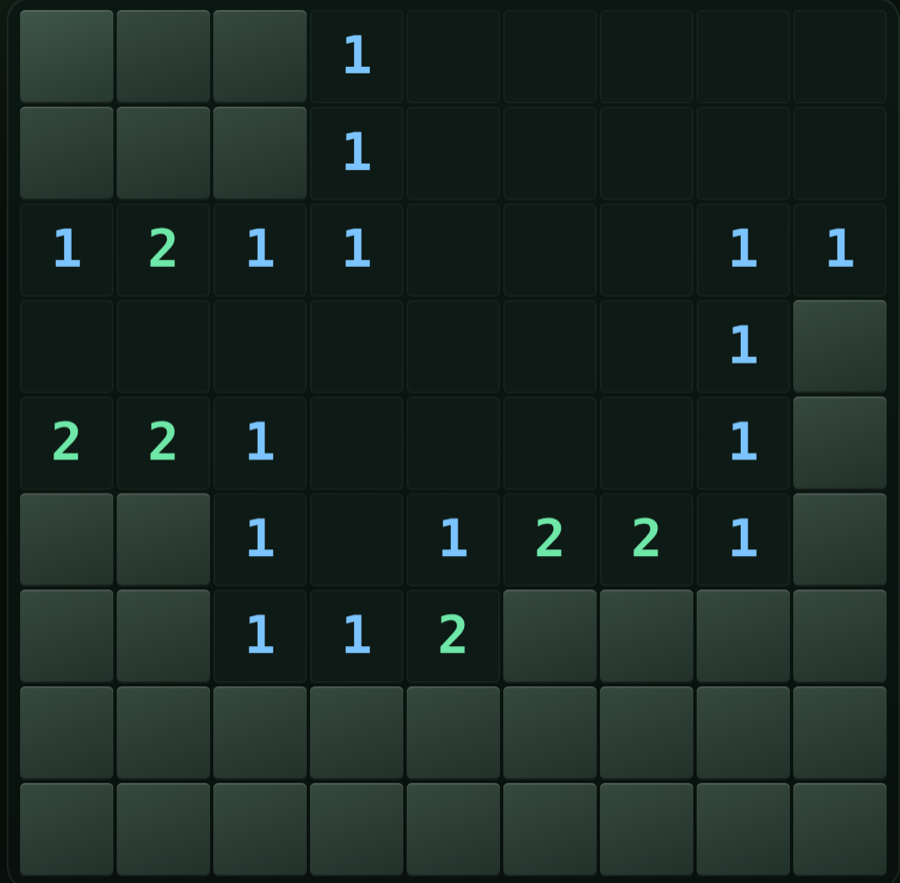
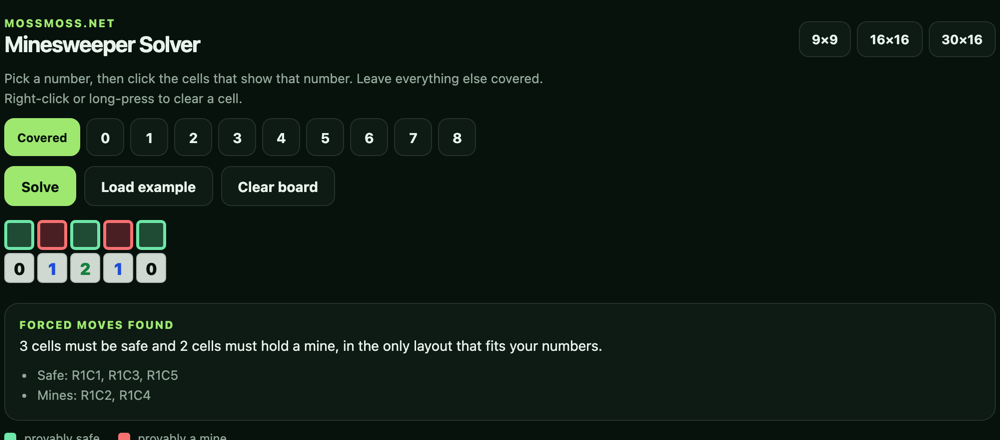

# No-guess Minesweeper engine

The deterministic board generator, logic solver and 3BV scorer behind
**[minesweeper on mossmoss.net](https://mossmoss.net/games/minesweeper/)**.





It is plain JavaScript with no dependencies and no DOM access, so the same file
runs in a browser, in Node, and in the automated tests that gate the site.

- **Deterministic boards.** FNV-1a hashes a seed into a 32-bit integer, then
  mulberry32 produces the mine layout. The same seed and first click always
  produce the same board, which is what makes
  [shared challenge links](https://mossmoss.net/games/minesweeper/) reproducible.
- **First-click safety.** The opening click and its eight neighbours are excluded
  from mine placement, then the opening area is flood-filled.
- **No-guess boards.** `generateBoard({ noGuess: true })` generates, runs the
  solver, and regenerates until the board is solvable by deduction alone. The
  returned board carries `noGuessFailed: false` when the guarantee holds.
- **Constraint solver.** `solvePosition` applies single-cell counting rules,
  global mine counts, and exhaustive enumeration of connected frontier
  components. `countSolutions` counts every layout consistent with the visible
  numbers, which is how forced moves are identified.
- **Mine probabilities.** The per-cell counts returned by `countSolutions`
  divide by the layout total, giving the exact chance that a covered cell holds
  a mine. The same numbers back the
  [probability view](https://mossmoss.net/tools/minesweeper-solver/) that turns
  an unavoidable guess into the best available click.
- **3BV.** `compute3BV` returns the minimum number of left clicks needed to
  clear a board; the site divides it by time for 3BV/s.

## Files

| File | Purpose |
| --- | --- |
| `engine.js` | Board generation, solver, no-guess verification, 3BV |
| `test.mjs` | Determinism, mine counts, first-click safety, no-guess solvability |
| `demo.html` | A small playable board with a hint button, importing `engine.js` |

## Run it

```js
import { DIFFICULTIES, generateBoard, solvePosition } from "./engine.js";

const { cols, rows, mines } = DIFFICULTIES.expert;
const board = generateBoard({
  cols, rows, mines,
  seed: "my-seed",
  noGuess: true,
  firstIndex: Math.floor((rows >> 1) * cols + (cols >> 1)),
});

console.log(board.bv, board.attempts, board.noGuessFailed);
```

```sh
node test.mjs
```

To try the demo, serve the folder over HTTP (ES modules do not load from
`file://`):

```sh
python3 -m http.server 8000
# open http://localhost:8000/demo.html
```

## How the no-guess loop works

1. Draw a layout with the seeded PRNG, keeping the first click and its
   neighbours mine-free.
2. Flood-fill the opening so the solver starts from a real position.
3. Run the solver. If it clears the board using deduction only, return it.
4. Otherwise draw again from the same PRNG stream. `maxAttempts` and
   `timeBudgetMs` bound the loop; if both run out the board is returned with
   `noGuessFailed: true` so the caller can tell the player honestly.

The solver never guesses. `solvePosition` only reveals a cell when a counting
rule, the global mine count, or an exhaustive frontier enumeration proves it
safe in every consistent layout, and only flags a cell when every layout agrees
it is a mine.

## Measuring how often boards need a guess

`study.mjs` generates boards from fixed seeds, opens them at the centre exactly
as the game does, and runs the solver to count how many can be cleared without
guessing.

```sh
node study.mjs 10000
```

With 10,000 boards per difficulty:

| Board | Cleared by logic alone |
| --- | --- |
| Beginner 9x9, 10 mines | 83.8% |
| Intermediate 16x16, 40 mines | 61.1% |
| Expert 30x16, 99 mines | 11.5% |

The full write-up is at
[How often Minesweeper requires a guess](https://mossmoss.net/guides/minesweeper-guess-statistics/).

## Play it

- [Play Minesweeper online](https://mossmoss.net/games/minesweeper/) — Classic,
  verified No-Guess, a daily challenge, and a pattern trainer.
- [Minesweeper solver](https://mossmoss.net/tools/minesweeper-solver/) — enter a
  position to see every cell that is provably safe or provably a mine, plus the
  exact mine probability of the rest when nothing is forced.
- [Daily Minesweeper](https://mossmoss.net/games/minesweeper/daily/) — one board
  per difficulty per day, with past boards replayable by date.
- [Minesweeper patterns cheat sheet](https://mossmoss.net/guides/minesweeper-patterns/)
- [How No-Guess mode works](https://mossmoss.net/guides/minesweeper-no-guess/)
